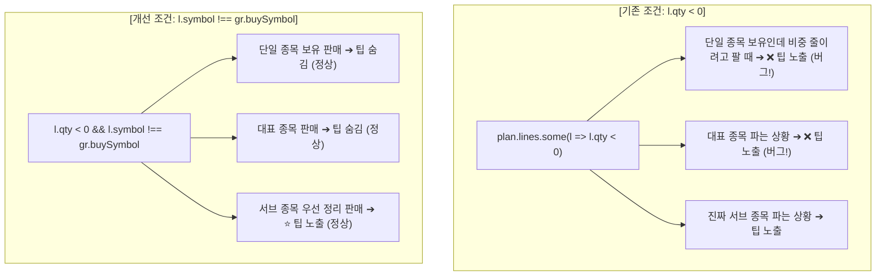

# 다종목 안내 팁 노출 조건 버그 수정 및 브라우저 탭 타이틀 통일 계획

## 1. 개요 및 원인 분석

### ① 브라우저 탭 타이틀 불일치
- **현상**: 브라우저 탭에 `나의 투자일지 (자산배분 & 리밸런싱 계산기) | jusik.app`처럼 지나치게 길게 노출됨.
- **원인**: 루트 레이아웃(`src/app/layout.tsx`)에 `template: '%s | jusik.app'`이 등록되어 있는데, `journal/layout.tsx`의 `title`에 괄호 설명문구가 길게 들어가 결합됨.
- **해결**: `title: '나의 투자일지'`로 단일화하여 다른 페이지들과 일관되게 **`나의 투자일지 | jusik.app`**으로 깔끔하게 표시.

### ② "다종목 보유 자산군" 판매 안내 팁 오작동 (버그)
- **현상**:
  - 대표 종목 외의 다른 종목을 팔지 않거나, 자산군에 종목이 1개뿐인데도 주식 판매(`qty < 0`)가 발생하면 무조건 아래 안내 문구가 노출됨:
    > "다종목 보유 자산군: 앞으로 모아갈 대표 종목을 보존하기 위해, 대표 종목이 아닌 다른 보유 종목부터 우선 정리하도록 계산됩니다."
  - 사용자가 기존 종목에서 다른 종목으로 교체하고 기존 종목을 삭제했음에도 불구하고, 단일 대표 종목만 파는 상황에서 이 문구가 떠서 "삭제된 종목이 여전히 유령처럼 남아있나?" 하는 혼란과 버그를 초래함.
- **원인**:
  - `src/app/tools/journal/page.tsx` L5894의 조건문이 단순히 `plan.lines.some((l) => l.qty < 0)`로 되어 있어, **판매되는 종목이 실제로 대표 종목이 아닌 '다른 종목(서브 종목)'인지 확인하지 않고 모든 판매 건에서 무조건 노출**되었음.
- **해결**:
  - 판매 라인 중 **실제로 자산군의 대표 종목(`buySymbol`)이 아닌 서브 종목(`l.symbol !== gr.buySymbol`)이 판매 목록에 포함되어 있을 때만** 해당 안내 팁이 노출되도록 조건식 정밀화.
  - 추가로 종목 삭제 시 보유 수량이 있던 경우 예수금(`cash`)에 판매 대금이 정상 입금되도록 정합성 보강.

---

## 2. 시각적 구조 및 조건 비교 (Mermaid)



---

## 3. 세부 파일별 변경 계획

### ① `src/app/tools/journal/layout.tsx`
- `metadata.title`을 `'나의 투자일지'`로 수정 ➔ 브라우저 탭에 **`나의 투자일지 | jusik.app`** 통일.
- `openGraph.title` 및 `twitter.title`도 `'나의 투자일지 | jusik.app'`으로 통일.

### ② `src/app/tools/journal/page.tsx`
1. **다종목 안내 팁 노출 조건 정밀화 (L5894 부근)**:
   ```tsx
   {plan.lines.some((l) => {
     if (l.qty >= 0) return false;
     const gr = account?.groups.find((g) => g.id === l.groupId);
     return gr && l.symbol !== gr.buySymbol;
   }) && (
     <div className="p-3 rounded-xl bg-amber-500/10 border border-amber-500/25 ...">
       ...
     </div>
   )}
   ```
2. **종목 삭제 시 보유 수량 판매 대금 예수금 입금 정합성 보강 (L2576~L2635 부근)**:
   - 보유 수량이 있는 종목 삭제 시 전량 판매 대금(`totalAmount`)이 계좌 현금(`cash`)에 누락 없이 안전하게 합산 반영되도록 처리.

---

## 4. 검증 계획
1. `npm run verify` 루프 엔지니어링 6대 관문 전수 통과 확인
2. 브라우저 탭 타이틀이 정확히 `나의 투자일지 | jusik.app`으로 뜨는지 확인
3. 단일 대표 종목 판매 시 팁이 숨겨지고, 실제로 자산군 내 다른 종목이 판매될 때만 팁이 정상 노출되는지 확인
