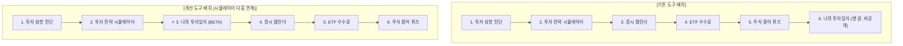

# 나의 투자일지 공개, 배치 순서 조정 및 계좌 3개 무료화 & SEO/GEO 강화 계획

## 1. 개요 및 사용자 피드백 반영
1. **투자도구 내 배치 순서 최적화**:
   - `투자 전략 시뮬레이터` 바로 다음 위치에 `나의 투자일지` 배치
   - **흐름**: 성향 진단 ➔ 전략 시뮬레이션(백테스트) ➔ **나의 투자일지(실제 포트폴리오 운용/리밸런싱)** ➔ 시장 캘린더 ➔ ETF 수수료 ➔ 용어 퀴즈
2. **일반 회원 무료 계좌 한도 확대 (2개 ➔ 3개)**:
   - 한국 개인 투자자의 3대 필수 계좌(연금저축, ISA, 일반 위탁/직투)를 모두 수용할 수 있도록 무료 제공 범위를 **최대 세 개(3개)**로 전격 확대
   - '치사하지 않은' 넉넉한 경험으로 유저 락인 및 만족도를 극대화하고, 4개 이상(가족 계좌, 배당 전용, 코인 분할 등) 헤비 유저에게 PRO 유도
3. **공개 전환 및 BETA 뱃지 적용**:
   - 관리자 제한 화면 해제 및 타이틀/네비게이션에 `BETA` 뱃지 노출
4. **SEO & GEO (생성형 AI 검색 최적화)**:
   - `sitemap.ts` 매일 색인 추가
   - `layout.tsx`에 `WebApplication` + `FAQPage` + `BreadcrumbList` 고밀도 JSON-LD 및 정밀 메타데이터 주입

---

## 2. 도구 배치 순서 (Before vs After)

---

## 3. 세부 파일별 구현 내역

### ① `src/app/tools/page.tsx` & `src/components/BottomNavigation.tsx`
- **도구 목록 순서**: `journal`을 `simulate` 바로 다음(3번째)으로 이동
- **상태 전환**: `isComingSoon: false`, `badge: 'BETA'` (또는 `tag: 'BETA'`) 적용
- 관리자 전용 예외 분기문 정리

### ② `src/app/tools/journal/page.tsx`
- **접근 제한 해제**: `if (!isAdmin)` 차단 블록 전면 삭제
- **BETA 뱃지 부착**: 헤더 `나의 투자일지` 옆에 오렌지 글래스모픽 `BETA` 뱃지 렌더링
- **무료 계좌 한도 확대**:
  - `data.accounts.length >= 2` ➔ `data.accounts.length >= 3`
  - 팝오버 문구 업데이트: *"무료 회원은 최대 세 개의 계좌(예: 연금저축, ISA, 일반 위탁)까지 등록할 수 있습니다. PRO 멤버십으로 업그레이드하면 가상자산, 가족 계좌 등 목적별 무제한 다중 계좌를 자유롭게 관리할 수 있습니다."* (순우리말 수관형사 '세 개' 준수)

### ③ `src/app/sitemap.ts`
- `/tools/journal` 경로 활성화 (`changeFrequency: 'daily'`, `priority: 0.9`)

### ④ `src/app/tools/journal/layout.tsx`
- 종합 메타데이터 및 `WebApplication`, `FAQPage`, `BreadcrumbList` JSON-LD 주입

---

## 4. 검증 계획
1. `npm run verify` 루프 엔지니어링 6대 관문 전수 통과 확인
2. 3계좌 추가 정상 작동 및 4번째 계좌 생성 시 PRO 팝오버 안내 확인
3. 도구 페이지 및 바텀 네비게이션 순서 및 BETA 뱃지 렌더링 점검
