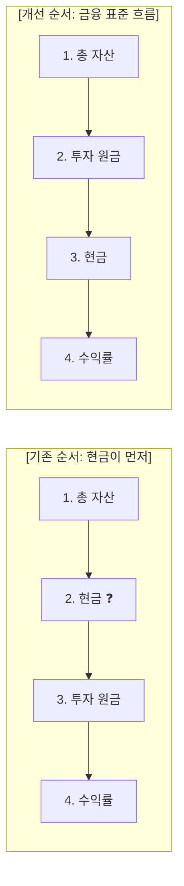

# 4대 지표 카드 순서 재배치 및 통합 탭 명칭 개선 계획

## 1. 개요 및 목적
1. **4대 지표 카드 순서 재배치**:
   - 기존: `총 자산` ➔ `현금` ➔ `투자 원금` ➔ `수익률`
   - 개선: **`총 자산` ➔ `투자 원금` ➔ `현금` ➔ `수익률`**
   - 전체 합산 뷰와 개별 계좌 뷰 모두 동일한 표준 순서로 재배열하여 재무적 인지 흐름(전체 자산 ➔ 투입 원금 ➔ 남은 현금 ➔ 최종 성과)을 최적화.
2. **첫 번째 탭 및 타이틀 명칭 개선**:
   - '통합 계좌'라는 표현이 별도의 독립된 실제 계좌처럼 오인될 수 있어, 사용자가 직관적으로 계좌들을 모아보는 기능임을 알 수 있는 명칭으로 전환.

---

## 2. 4대 지표 카드 순서 비교 (Mermaid)

---

## 3. 첫 번째 탭 및 타이틀 명칭 후보군
- **후보 1 (추천): `모아보기` / `내 자산 모아보기`**
  - 토스/뱅크샐러드 등 현대 핀테크 표준. '계좌'라는 단어를 빼서 별도 계좌로 혼동되지 않고, "내 모든 계좌를 모아본다"는 직관적이고 친근한 인상.
- **후보 2: `전체 합산` / `전체 계좌 합산`**
  - 기능적 본질(등록된 계좌들의 합계)을 가장 명확하고 담백하게 전달.
- **후보 3: `종합` / `종합 자산 현황`**
  - 증권사 MTS 스타일의 정갈하고 신뢰감 있는 클래식한 표현.
- **후보 4: `내 자산` / `내 전체 자산`**
  - 개별 계좌와 대비되는 최상위 자산 총괄 개념.

---

## 4. 세부 작업 위치
- `src/app/tools/journal/page.tsx`:
  - L3623~L3685: 첫 번째 뷰 4대 지표 카드 순서 재배치 (`총 자산` ➔ `투자 원금` ➔ `현금` ➔ `수익률`)
  - L4103~L4165: 개별 계좌 뷰 4대 지표 카드 순서 재배치 (`총 자산` ➔ `투자 원금` ➔ `현금` ➔ `수익률`)
  - L3437 부근: 상단 탭 버튼 라벨
  - L3576 부근: 헤더 타이틀 라벨
