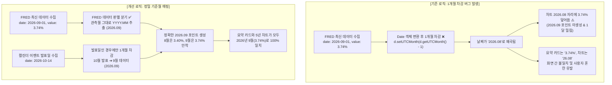

# 마켓 인사이트 소비자물가(CPI) 26년 9월 최신화 및 1개월 밀림 버그 수정 계획

## 1. 개요 및 목적
1. **소비자물가(CPI) 2026년 9월 최신 데이터 동기화**:
   - 10월 14일 공식 발표된 미국 9월 CPI 확정치(3.74%)를 정적 파일 및 동적 API에 반영.
2. **런타임 1개월 밀림(Shift) 버그 원천 해결**:
   - FRED 공식 CSV에서 관측월(`2026-09-01`)을 수집했을 때 1개월 차감하던 로직을 수정하여, 매월 새로운 데이터 수집 시 날짜가 왜곡되지 않고 정상 축적되도록 엔진 개선.

---

## 2. 버그 발생 메커니즘 및 개선 구조 (Mermaid)

---

## 3. 세부 작업 내역
1. `src/utils/marketCalendarSync.ts`:
   - FRED 관측월(`cpiDate`, `unemploymentDate`) 직접 매핑 분기 추가 (`isCpiObservationMonth`).
2. `src/data/marketCalendar.ts`:
   - `MACRO_SUMMARY_ITEMS`: 소비자물가 3.74% 최신화.
   - `MACRO_ASSET_CHARTS.CPI_YOY`: 3.74%, 5년 변동폭 -1.65%p, 2026.09 포인트 추가(60개월 슬라이딩 유지).
3. `src/app/api/market/daily/route.ts` & `src/components/calendar/MarketWeatherSection.tsx`:
   - 캐시된 차트가 최신 코드 정의보다 이전 날짜일 경우 코드 정의를 우선 채택하는 방어 로직 적용.
