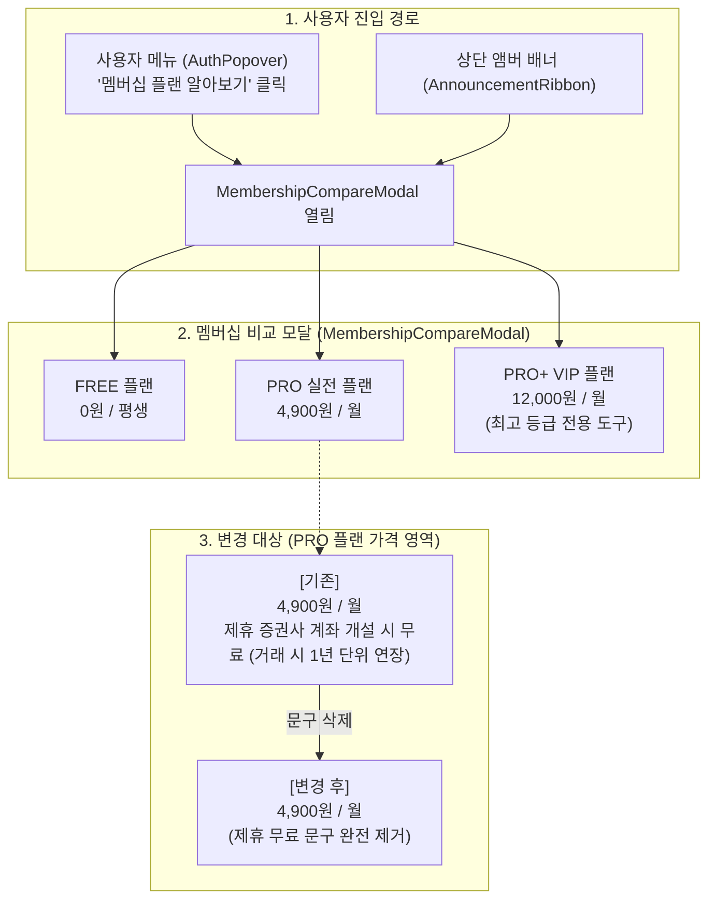

# 프로 멤버십 플랜 내 '제휴 증권사 계좌 개설 시 무료' 문구 제거 작업 계획

## 1. 개요 및 목적
- **배경**: 현재 멤버십 플랜 비교 모달(`MembershipCompareModal.tsx`)의 PRO 플랜 가격 영역에 `제휴 증권사 계좌 개설 시 무료 (거래 시 1년 단위 연장)` 안내 문구가 노출되고 있습니다.
- **목적**: 제휴 계좌 개설 연계 전략이 확정되지 않은 상태이므로, '멤버십 플랜 알아보기' 모달 내 해당 문구를 깔끔하게 제거하여 불확실한 혜택 안내를 선제적으로 배제합니다.

---

## 2. 시각적 구조도 (Mermaid Diagram)



---

## 3. 세부 수정 계획

### 대상 파일: `src/components/MembershipCompareModal.tsx` (Line 322~331)

#### 수정 전 (Before)
```tsx
{/* Price & Badge Preview */}
<div className="py-2.5 border-y border-[var(--border-color)]/60 flex items-center justify-between">
  <div>
    <div className="flex items-baseline gap-1">
      <span className="text-2xl sm:text-3xl font-black font-mono text-[var(--text-primary)]">4,900원</span>
      <span className="text-xs text-[var(--text-secondary)]">/ 월</span>
    </div>
    <div className="text-[10px] text-[var(--accent-orange)] font-medium pt-0.5">
      제휴 증권사 계좌 개설 시 무료 (거래 시 1년 단위 연장)
    </div>
  </div>

  {/* Badge Preview */}
  <span 
    className="animate-pro-badge inline-flex items-center gap-1 px-2.5 py-1 rounded-full text-[10.5px] font-extrabold font-mono text-[var(--accent-orange)] bg-[var(--accent-orange)]/15 border border-[var(--accent-orange)]/50 select-none shadow-2xs"
    title="PRO 앰버 뱃지"
  >
    <Crown className="w-3 h-3 stroke-[2.4] fill-[var(--accent-orange)]/20" />
    <span>PRO</span>
  </span>
</div>
```

#### 수정 후 (After)
```tsx
{/* Price & Badge Preview */}
<div className="py-2.5 border-y border-[var(--border-color)]/60 flex items-center justify-between">
  <div>
    <div className="flex items-baseline gap-1">
      <span className="text-2xl sm:text-3xl font-black font-mono text-[var(--text-primary)]">4,900원</span>
      <span className="text-xs text-[var(--text-secondary)]">/ 월</span>
    </div>
  </div>

  {/* Badge Preview */}
  <span 
    className="animate-pro-badge inline-flex items-center gap-1 px-2.5 py-1 rounded-full text-[10.5px] font-extrabold font-mono text-[var(--accent-orange)] bg-[var(--accent-orange)]/15 border border-[var(--accent-orange)]/50 select-none shadow-2xs"
    title="PRO 앰버 뱃지"
  >
    <Crown className="w-3 h-3 stroke-[2.4] fill-[var(--accent-orange)]/20" />
    <span>PRO</span>
  </span>
</div>
```

---

## 4. 검증 계획
1. **정적 무결성 및 루프 엔지니어링 검증**:
   - `npm run verify` 실행:
     - TypeScript 타입 컴파일 에러 여부 점검 (`tsc --noEmit`)
     - 도메인 금지어 규칙 점검 (매수/매도/주가/시가총액/수관형사)
     - 시크릿 및 비밀값 누출 여부 점검
2. **UI/UX 레이아웃 점검**:
   - 문구 제거 후 FREE, PRO, PRO+ 3단 카드의 상하 정렬 및 높이 균형 점검
   - 모바일 및 데스크톱 뷰포트에서 깨짐 없이 정상 렌더링되는지 확인
