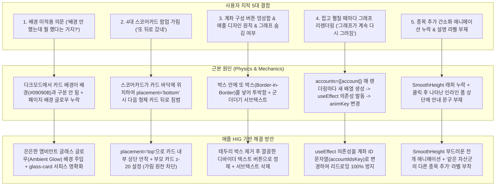

# 투자일지 5대 핵심 결함 해결 및 애플 HIG 디자인 정제 계획

## 1. 사용자가 지적한 5대 핵심 결함 및 원인 분석

---

## 2. 항목별 세부 해결 계획

### ① 배경 관련 원인 및 개선안 ("배경 안 했는데? 뭘 했다는 거지?")
* **현상**: 다크 모드에서 배경(`--bg-main: #09090B`)과 카드의 배경색이 거의 같고, 페이지 뒤편에 깔리는 배경 효과가 없어 "그냥 까만 화면에 테두리 선만 그어진 것 같다"고 느껴짐.
* **해결책**:
  1. 마켓 캘린더나 성향 진단처럼 투자일지 메인 컨테이너 뒤편에 **은은한 앰비언트 메시 오로라 글로우(Ambient Glow Background)**를 배치하여 깊이감 부여.
  2. 카드 배경(`cardCls`)을 `glass-card` 규격으로 배경과 확실히 분리되는 서피스 음영을 주어 글래스모피즘 입체감을 완성.

### ② 4대 성과 스코어카드 팝업 가림 완전 해결
* **물리적 원인**: 스코어카드가 카드의 맨 바닥에 위치해 있는데, 팝업이 아래쪽(`placement="bottom"`)으로 튀어나오면서 다음 형제 요소인 '현금 및 운용 설정' 카드의 영역을 침범하고, 형제 요소의 쌓임 맥락(Stacking Context)에 의해 아래 카드의 뒤로 가려짐.
* **해결책**:
  1. 팝업 위치를 **위쪽(`placement="top"`, `bottom-full mb-2.5`, `origin-bottom-right`)**으로 변경.
  2. 스코어카드 바로 위는 넓은 차트 영역이므로, 카드 내부 안전 영역 안에 쏙 들어가 아래 카드와 겹칠 일이 100% 원천 차단됨.
  3. 부모 카드에 `relative z-20`을 명시하여 혹시 모를 레이어 간섭 완벽 차단.

### ③ 계좌 구성 토글 버튼 애플 HIG 정제 및 상단 그래프 처리 제안
* **군더더기 텍스트 삭제**: 우측의 `자산군·종목·월별 실적` 구구절절한 텍스트 완전 삭제.
* **박스-인-박스 탈피**: 투박한 회색 테두리 박스 버튼을 버리고, 카드 하단에 자연스럽게 녹아드는 **은은한 인라인 디바이더 버튼**으로 정제 (`ChevronDown` 회전 화살표만 심플하게 배치).
* **위쪽 그래프와 수익률 숨김 여부에 대한 애플식 대안**:
  - **총 자산 / 투자 원금 / 현금 / 수익률 4대 지표**는 계좌의 핵심 정체성이므로 항상 상단에 유지.
  - **자산 추이 그래프 + 4대 스코어카드**: 높이(약 320px)를 차지하므로, 사용자가 "이번에 뭐 살지 계산"에 집중하고 싶을 때 스크롤을 줄일 수 있도록 **차트 접기/펼치기 토글**을 추가하거나, 그래프 여백을 컴팩트하게 정돈.

### ④ 접고 펼칠 때마다 그래프 다시 그려지는 버그 수정
* **물리적 원인**: 부모가 리렌더링될 때 `accounts={[account]}`가 매번 새로운 배열 참조를 생성하여 `useEffect(..., [accounts, logs.length, chartSpan])`가 발동되고, `setAnimKey(Date.now())`로 인해 SVG가 매번 처음부터 다시 그려짐.
* **해결책**:
  - `const accountIdsKey = useMemo(() => accounts.map(a => a.id).join(','), [accounts]);`
  - `useEffect`의 의존성을 `[accountIdsKey, logs.length, chartSpan]`으로 변경하여, 계좌 데이터나 기간이 실제로 바뀌지 않는 한 아코디언을 열고 닫아도 그래프가 절대 다시 그려지지 않음.

### ⑤ 자산군 내 종목 추가 애니메이션 및 설명 라벨
* `<SmoothHeight>` 래퍼를 적용하여 `+` 버튼 클릭 시 부드럽게 스르륵 펼쳐지도록 구현.
* 새로 나타난 입력창 상단에 `<Plus className="w-3.5 h-3.5" /> 같은 자산군의 다른 종목 추가` 오렌지색 안내 라벨을 선명하게 표시.
